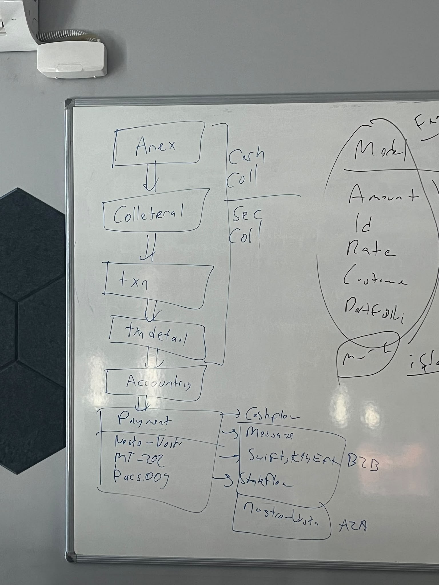

# 10 — Patron Toplantısı (2026-10-08) — Kararlar ve Açık Sorular

> **Kaynak:** [`../Collateral-toplantı-ses-kaydı-2.pdf`](../Collateral-toplantı-ses-kaydı-2.pdf) — ~55 dk, 38 sayfa ASR
> transcript'i. Konuşmacı adları transcript'te yok ("Konuşmacı 1…7"); aşağıdaki atıflar **içerikten
> çıkarım** (ER diyagramını sunan = Selim, karar veren = patron).
> ⚠️ ASR Türkçe karakterleri ve terimleri bozuyor ("Revolution" = Revaluation, "Finple/FIMPL" = Fimple,
> "Taksen" = Transaction). Transcript'in **son ~%40'ı konu dışı** (fon tasfiyesi sohbeti) — iş kararı yok.
>
> **Ne zaman oku:** tablo tasarımına (Excel v6), Faz 4 script'ine, muhasebe/ödeme tasarımına başlamadan önce.

---

## 1. Modül adı — kesinleşti

| | |
|---|---|
| **Ad** | **ColManagement** — `Col` = **Col**lateral'in kısaltması (Collateral Management). Murex de "Collateral Management" terimini kullanıyor |
| **Karışıklık** | Toplantıda bir kişi `Col`'u "Call" (çağırmak) sandı — kısaltma C-O-L, telaffuz aynı |
| **Yazım** | Kullanıcı 2026-10-09: *"Col kelimesi collateral kısaltması olduğu için Management'teki M büyük olmalı"* → **`ColManagement`** (PascalCase iki kelime) |

---

## 2. 🔴 Scaffolding — yeni mikroservisler artık ortak şablonla açılıyor

Bir konuşmacı (mikroservis altyapısının sahibi): *"Scaffolding artık bizim yeni mikroservis scaffolding var.
Bütün mikroservisler onunla açılıyor"* — Reporting, FI, iki integration servisi dahil **5-6 servis**.
*"Bana namespace'ini verin, reposunu verin, hemen pat diye açıyor."* Ayrıca **tek folder altında**
default bir klasör yapısı (ayrı bir "folder reposu") gelecek; POC'si yapılmış.
ColManagement için *"ismi bile daha netleşmedi"* dendi, *"onları bana verin, ben açayım"* teklifi var.

🔴 **Etkisi:** elle kurduğumuz 54 projelik iskelet (OptionsFX zinciri) ile scaffolding çıktısı **ayrışabilir**.
→ **A-22**: scaffolding şablonu/reposu istenmeli ve iskeletle **karşılaştırılmalı** — ayrışma varsa hangisinin
kazanacağı kullanıcı kararı. Şablon görülmeden üstüne iş kodu yığmak geri dönüşü pahalılaştırır.

---

## 3. Kapsam

| Konu | Karar / söz |
|---|---|
| **Faz 1** | **Nakit teminat** (cash collateral) — sözleşme (CSA/GMRA tipi; ASR'de "izah-icma") kapsamındaki işlerin teminatı |
| **Faz 1.5** | **Menkul kıymet teminatı** (sec collateral) — *"base'ini koyalım, en azından mantığını düşünelim"*. Aynı ekrandan yönetilecek. Kıymetin fiyatı düşerse teminat değişmese bile ek teminat gerekir → değerleme orada doğar |
| **Uzun vade** | Murex tarzı tam collateral management (repo/FI teminatları dahil tek modülde) — *"çok yakın vade planımızda olması zor"* |
| **Motivasyon** | Bankalar Excel/Word'le **tamamen manuel** takip ediyor. Bir müşteride back office günde **~70 serbest fiş** elle kesiyor (nemalandırma) → BDDK serbest fiş sayısını soruyor. Takasbank neması aylık toplu muhasebeleştiriliyor → para bilançoda görünmüyor, hazine "10 milyon eksiğimiz var" diyor. *"Şu an asıl amaç orayı kurtarmak"* |
| **Otomasyon sınırı** | Teminat çağrısı telefonda pazarlıkla dönüyor (*"170 bin artıdasın" → "sen bana 30 gönder"*). Tam otomasyon operasyonel yükü sanıldığı kadar azaltmaz; **önce görünürlük ve muhasebe** |

---

## 4. Tablolar — ER diyagramı (Excel v5) üzerinden

Kullanıcı (2026-10-09): *"Annex tablosu mantıklı, AnnexProductScope mantıklı da AnnexMarginRule kısmında
ProductScope'a bağlı olması ve buna ihtiyaç olunmasını tam anlayamadılar… tablolar kesin değil, tabloları
şimdilik bırakalım."*

| Tablo grubu | Toplantıda ne dendi | Durum |
|---|---|---|
| **Annex** | 2-3 tablo olacak. Annex'in **tek tanımı** var | ✅ kalıyor |
| **AnnexProductScope** | Sözleşmenin hangi ürün/alt ürünü kapsadığı (include/exclude) — mantıklı bulundu | ✅ kalıyor (A-21 katalog sorusu açık) |
| **AnnexMarginRule** | Kural hep **iki taraf**: Own + Counterparty. *"Dört alanı sekiz yaparız, hep iki tarafsa ana tabloyu annex'in üzerine koyabiliriz."* ProductScope'a bağlanması **tanım ekranında görülmüyor** — *"soralım bir daha"* (Alpa biliyor olabilir). Currency'e göre değişen birden çok kural olup olmadığı da hatırlanamadı | 🔴 **TARTIŞMALI** → A-24 |
| **CollateralDefinition** | *"Bir tane collateral tablosu olacak. Burada az alan var, bunun daha çok olması lazım."* Security/Cash için ayrı tanım tabloları belirsiz | 🟡 genişleyecek |
| **CollateralRevaluation** | *"Revaluation falan yok"* — Selim UML'den sildi | ❌ **SİLİNDİ** |
| **Tax / Message tabloları** | *"Bu tax on message bilmem ne, bu nereye girmiş bu kadar?"* — dokümandan gelen şişkinlik olarak görüldü | 🟡 sorgulandı |
| **Payment section** | *"Şu kalacak büyük bir ihtimalle"* | 🟡 ödeme kararına bağlı (§6) |
| **TxnTransaction** | Annex'li **veya** annex'siz collateral kullanır | ✅ |
| **TxnTransactionDetail** | 🔑 Her **ekle / çıkar / artır / azalt** → **yeni detail satırı**; önceki detail'lar kapatılır (*"page out'a çekilecek"*). *"History değil, change — giden gelen bir şey."* Diğer hazine ürünleri aynı satırı edit eder; burada **yapılmayacak** | ✅ **YENİ TABLO** — Excel v5'te yok |
| **Neden master-detail** | İleride detail'lara işlemler **N-M** bağlanacak: *"Senin buna bağladığın on tane işlem bunlar"* + önerilen tutar (suggestion) | 🔑 tasarım gerekçesi |

**Ekranlar:** Annex · Collateral · Transaction — *"en sıkıntılı ekran transaction ekranı"*.

**Sıradaki iş (patron):** *"Annex'in tanımlarından başlayın, database'leri bir tanımlayın."*
Selim 2026-10-09'da analist + bir kişiyle başlayacak; DB'yi bir başkası onaylayacak.

---

## 5. Muhasebe

| | |
|---|---|
| **Tetik** | Her `TxnTransactionDetail` değişikliğinde **bir muhasebe fişi + bir ödeme mesajı** |
| **Normal muhasebe** | Para transferi — nostro hareketi, SWIFT **MT202** |
| **Nazım hesap** | Patron teminat değerini **nazım hesaplarda (996-998)** izlemek istiyor: açılışta +10.000, detail'da −1.000 → nazımda 9.000 durur. *"Müşteriden talep gelir mi bilmiyorum ama olması lazım"* — FX'te türev kâr/zararı, diğer üründe nominaller nazıma yazılıyor. Analist bunu hiç görmediğini söylemiş |
| → | **A-25**: nazım (off-balance) bacağı faz-1'de mi |

---

## 6. 🔴 Fimple ve ödeme sistemi

> 🔄 **DÜZELTME (kullanıcı, 2026-10-09):** *"Fimple tamamiyle kullanılacak, onu yanlış anlamışsın. Sadece ödeme
> mesajlarını biz kendi tarafımızda mı yapacağız yoksa Fimple'da mı yapılacak anlamındaki konuşmaydı o."*
> Transcript'teki *"Fimple burada hiç olmayacak"* cümlesi **yalnız ödeme mesajı** bağlamındadır.
> → **Fimple entegrasyonu (auth, muhasebe senkronu, bildirim) diğer modüllerdeki gibi KULLANILIR.** A-23 kapandı (K-43).

| Söz | Doğru okuma |
|---|---|
| *"Fimple burada hiç olmayacak."* · *"Fimple almayacak bu işi ve bu işin back office'ini yapmayacak."* | **Ödeme mesajı** üretimini Fimple'ın mı bizim mi yapacağı tartışması — modülün genel Fimple bağı değil |
| *"Fimple diyor ki artık bana yeni işlem senkronize etme… benim API'larım var diyor."* | Platform genelinde yön: back office (limit, ödeme) modüllere geçiyor |
| *"K14'ün modeli var Fimple'da. O modeli dolduracak, atacak Fimple'a."* | Ödeme **mesajı** Fimple API'si üzerinden gidebilir |

**Kullanıcının netleştirdiği faz-1 yaklaşımı (2026-10-09):** *"Ödeme mesajları işine girişirsek ColManagement
modülü geliştirmesini de geçer bu işin büyüklüğü. Muhtemelen Fimple'da ödeme mesajını oluşturacaklar ve bizim
tarafa ödeme mesajı diye bir alan koyabiliriz… orada ki alanı true yaparlar ve kaydedilirse de ödeme mesajı
gitmiştir diyebiliriz şimdilik."* → Faz 1'de ödeme sistemi **yazılmaz**; detail üzerinde bir **"ödeme mesajı
gönderildi" bayrağı** (bool) olur, kullanıcı işaretleyip kaydeder (A-26).

**Ödeme sistemi tasarımı (ürün kataloğu sonrasına bırakılmıştı):** cash flow → (varsa) ödeme mesajı →
**rail resolve** (SWIFT / SEPA / EFT / …) → TL ise K12/K14/K16, döviz ise MT202 → mesaj **state takibi**
(gitti mi, amendment). *"Bu modüldeki en büyük challenge'ımız bu."* Netting'e hiç girilmedi.

| Seçenek | Patronun sözü |
|---|---|
| **Faz 1 manuel** | *"İlk phase'de ödemeler komple manuel"* — bir alan: "Payment sent / successful"; EFT/SWIFT elle atılır, buradan güncellenir |
| **Workaround yasak** | *"Burayı MT299 gibi çakma yapamayız… gerçek para girip çıkıyor"* |
| **Disable** | *"Onu disable edebiliriz ilk etapta"* |

~~A-23~~ ✅ Fimple kullanılıyor. **A-26** 🟡 faz-1 = bayrak alanı; kesin karar henüz verilmedi.

---

## 6b. 🔑 Tahta (EkranGoruntusu.jpeg) — işin özü

 — [`../EkranGoruntusu.jpeg`](../EkranGoruntusu.jpeg)

Tahtanın **sol tarafı** bu iş; sağ taraf (*Model: Amount, Id, Rate, Customer, Portfolio…*) başka konu.

```
 Annex ──► Collateral ──► Txn ──► TxnDetail ──► Accounting ──► Payment
 └──────────── Cash Coll (faz 1) / Sec Coll (faz 1.5) ───────┘     ├─ Nostro-Vostro · MT-202 · pacs.009
                                                                   ├─► Cashflow
                                                                   ├─► Message (Swift · K14 · EFT) — B2B
                                                                   ├─► Stateflow
                                                                   └─► Nostro-Vostro — A2A
```

**Kullanıcının özeti (2026-10-09):** *"3 tane ekranımız olacak — Annex ekranı, Collateral ekranı, Txn ekranı —
ve bu ekranlar için birden fazla tablo olabilir. Tüm geliştirmemizin amacı bu aslında. Buradaki en önemli iş:
Txn ekranında her işlem için işleme girip edit yapılmayacak, TxnDetail olacak ve o detail'a yansıyacak; yani
ana Txn hiç değişmeyecek ve her işlem TxnDetail'da değişecek."*

🔴 **Tasarım ilkesi (K-44):** `TxnTransaction` **açıldıktan sonra değişmez**. Her teminat hareketi
(ekle / çıkar / artır / azalt) **yeni bir `TxnTransactionDetail` satırıdır**; önceki detail'lar kapatılır,
silinmez/ezilmez. Muhasebe (ve faz-1'de ödeme bayrağı) **detail'dan** doğar. Diğer hazine modüllerindeki
"edit et → yeni fiş" deseni burada **kullanılmaz**.

---

## 7. Bağımlılıklar (bu modülün işi değil ama etkiliyor)

- **Counterparty** yeniden yapılanacak: ortam bazlı dış ID eşlemesi (Bloomberg, 360T, Integral… ID'leri
  modülde değil counterparty'de) + **yapılandırılmış adres** (SWIFT artık detaylı adres istiyor; ülke/il/ilçe
  seçimli). *"Counterparty'nin yarısını değiştirmemiz gerekiyor."*
- SEPA geliyor; counterparty'de BEN kod + SWIFT kod yan yana kolonlar yetmeyecek.
- Menkul kıymet teminatı → **MT5xx** mesajları (*"en pis mesaj"*) — sonra.

---

## 8. Açık sorular (→ [`07-kararlar-ve-sorular.md`](07-kararlar-ve-sorular.md)'e de işlenecek)

| # | Soru |
|---|---|
| **A-22** | ⏸ Scaffolding karşılaştırması — kullanıcı: *"bu konu bir dursun sonra bakıcaz"* |
| ~~A-23~~ | ✅ Fimple **tamamen kullanılıyor** — yalnız ödeme mesajının yeri tartışmalıydı (K-43) |
| **A-24** | `AnnexMarginRule` ayrı tablo mu, Annex üzerinde Own/Cp × 4 = 8 kolon mu; ProductScope'a bağlı mı |
| **A-25** | Nazım (996-998) muhasebe bacağı faz-1'de mi |
| **A-26** | 🟡 Ödeme faz-1: detail'de **"ödeme mesajı gönderildi" bayrağı** (kullanıcı eğilimi, kesin değil) |
| **A-27** | `TxnTransactionDetail` kolonları + "kapatma" alanı (`IsActive`/`EndDate`/`ClosedByDetailId`?) |
